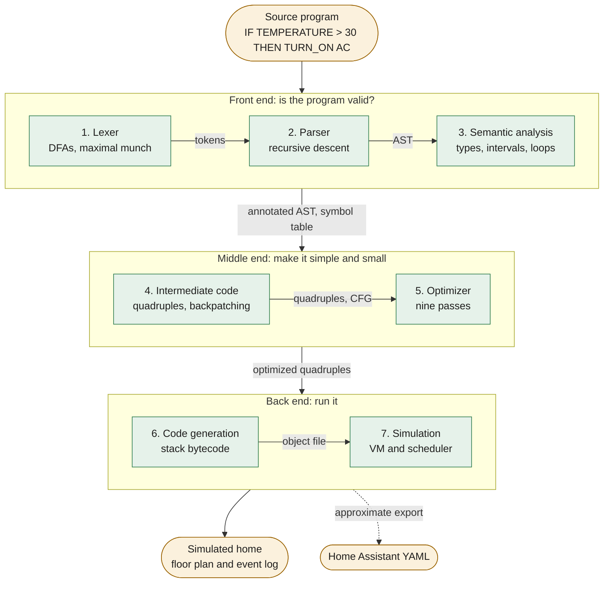
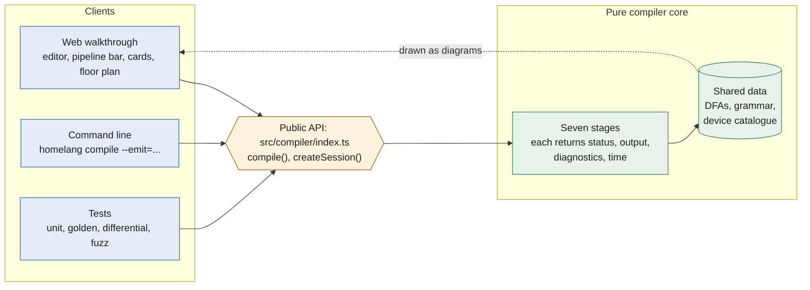
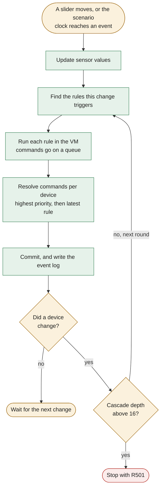
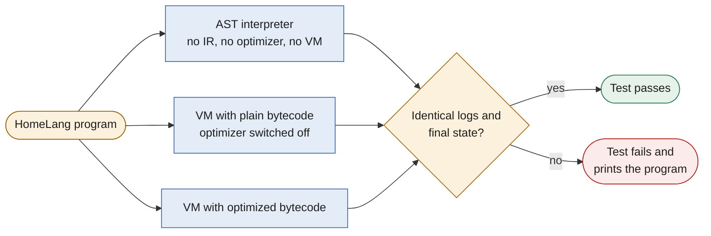

# HomeLang

A complete compiler for a smart-home automation language (`IF TEMPERATURE > 30 THEN TURN_ON AC`), with a live, phase-by-phase visual walkthrough from lexer to simulated home.

## Run it

```sh
npm install
npm run dev        # open the walkthrough
npm test           # unit, golden, error-suite, differential and fuzz tests
npm run test:e2e   # browser smoke tests (needs Google Chrome)
npm run build      # type-check and build the static site and the CLI
npm run ll1        # prove the grammar is LL(1)
```

The site is static and works offline once built: serve `dist/` from anywhere.

### Command line

```sh
npm run homelang -- compile examples/brief.home --emit=tokens
```

`--emit` accepts `tokens`, `ast`, `symbols`, `ir`, `opt`, `bytecode` or `sim`. After `npm run build`, the same tool is available as `node dist-cli/homelang.js`.

## Architecture

### The compiler pipeline

Each phase is a pure function that hands its result to the next. A phase with errors stops the pipeline, and every later stage is reported as skipped. Warnings do not stop it.



| # | Phase | Code | What it does |
|---|---|---|---|
| 1 | Lexer | `src/compiler/lexer/` | Hand-written maximal-munch lexer running on DFAs stored as data |
| 2 | Parser | `src/compiler/parser/` | Hand-written LL(1) recursive descent, with parse tree and AST |
| 3 | Semantic analysis | `src/compiler/semantic/` | Symbol table, types and units, interval analysis, conflict and loop detection |
| 4 | Intermediate code | `src/compiler/ir/` | Quadruples with backpatching, and a control-flow graph |
| 5 | Optimizer | `src/compiler/opt/` | Nine passes, each with a safety argument |
| 6 | Code generation | `src/compiler/codegen/` | Stack-VM bytecode, plus an approximate Home Assistant export |
| 7 | Simulation | `src/compiler/runtime/` | VM, scheduler and floor-plan simulator |

### How the project fits together

The compiler is a pure core with no knowledge of the page. The web page and the command line both use one public file, and a test fails if the UI imports anything else. The DFAs and the grammar are data, so the diagrams on the page are drawn from the same objects the compiler runs on.



### One tick of the simulated home

Rules are edge-triggered: THEN runs when a condition changes from false to true, and ELSE when it changes back. A device change is an event, so one tick can cascade through several rounds. The depth limit of 16 stops a runaway loop with error R501.



### Why the optimizations are safe

Each program runs three ways, and all three must produce the same event log and the same final home. This runs on every example, on programs written to stress each pass, and on 400 random programs. To check the test itself, 13 parts of the compiler were broken on purpose, and the suite failed every time.



## Documentation

- [Language reference](docs/language-reference.md)
- [Design decisions](docs/DECISIONS.md)
- [Progress](docs/PROGRESS.md)

## Team

Course: Compiler Design

1. Deepanshu Mehta
2. Vishesh
3. Pranay Vishwakarma
4. Ankush
5. Manu Vahan
