# Design direction: the drawing set

This is the final design as built. The measured results are at the end.

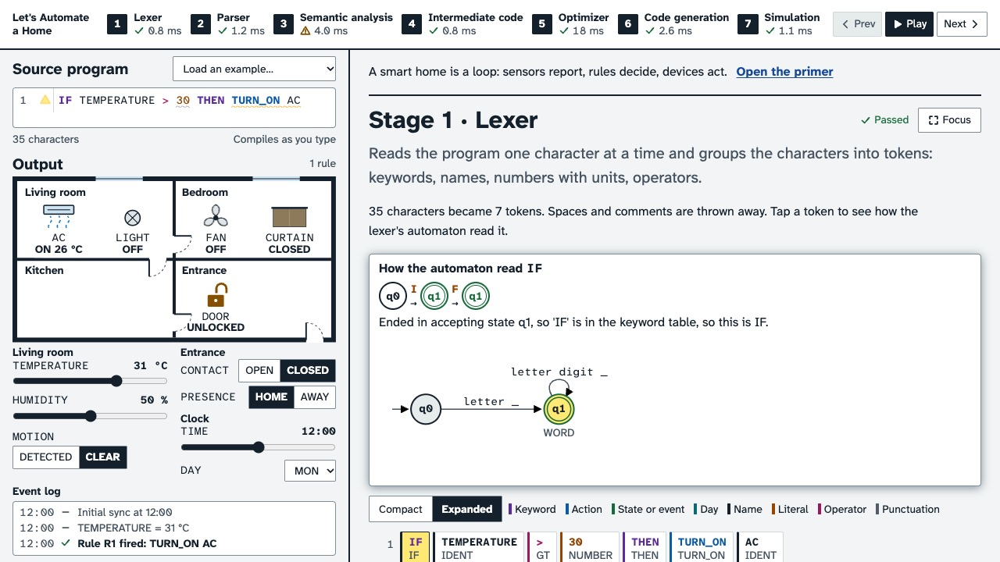

## The idea

A house is built from a set of drawings. Each sheet shows one aspect, numbered in order, and the set ends with the plan you can walk through.

This page is the same thing. Each compiler stage is a numbered sheet, and the last sheet is the home itself, drawn the way an architect draws it: solid black walls, door swings, windows in the wall line, and fixtures in plan view.

**Who it's for:** a class watching a projector, with one student presenting.

**Its job:** make each phase readable from the back row, and end on a home that reacts.

**The one bold thing:** the floor plan. Everything else stays quiet so that it lands.

"Sheet" is only the visual metaphor. Every visible label says "Stage", to match the course and the instructor's demo: `Stage 2 · Parser`, and "Stopped at stage 2: Parser".

## How this was tested against the obvious answers

| First instinct | Why I dropped it | What replaced it |
|---|---|---|
| Blueprint: white lines on blue | It's the cliché for anything architectural, and dark backgrounds wash out on projectors | Black ink on pale film, the way real plans are printed |
| IBM Plex, the usual "technical" choice | It's a default, and nothing about it answers this brief | Atkinson Hyperlegible, chosen for the real constraint: reading from far away |
| Serif headings for an "editorial" feel | Thin strokes vanish on a projector, and cream with a serif is a generated-page look | Editorial comes from pacing and measure, not a serif |
| Drafting grid across the whole page | Decoration that competes with the content | The grid appears only inside tree and plan views, where position means something |

## Colour

All values are computed. Text clears AA on both backgrounds, and stays above 4.3:1 with an 18% wash that imitates a projector in a lit room.

| Token | Hex | Role | On film | On sheet |
|---|---|---|---|---|
| `--film` | `#F2F5F5` | Page background: cool, not cream | | |
| `--sheet` | `#FFFFFF` | Editor, tables, tree and plan views | | |
| `--ink` | `#14202B` | Text, walls | 15.1 | 16.5 |
| `--graphite` | `#465360` | Secondary text | 7.2 | 7.9 |
| `--link` | `#16489A` | Links, focus, selection | 7.9 | 8.7 |
| `--rule-strong` | `#7F8D96` | Control outlines | 3.1 | 3.4 |
| `--marker` | `#FFE873` | The teaching highlight: "look here" | | |

The highlighter yellow is the one accent, and it always means the same thing: the current stage, grammar rule, node or source span. It never appears as decoration. Ink stays 13:1 on it.

**Token classes** match the editor and the chips. Each chip also prints its type, so colour is never the only signal.

| Class | Hex | On sheet |
|---|---|---|
| Keyword | `#5A2A9E` | 9.3 |
| Action | `#0A5AA8` | 6.9 |
| State and event | `#176B3A` | 6.6 |
| Day | `#086A73` | 6.3 |
| Name | `#14202B` | 16.5 |
| Literal | `#964400` | 6.7 |
| Operator | `#A0165A` | 7.6 |
| Punctuation | `#505C68` | 6.8 |

**Diagnostics** always pair colour with an icon and the word.

| Kind | Hex | On its tint | Icon |
|---|---|---|---|
| Error | `#AE1620` | 6.3 | Cross |
| Warning | `#855000` | 6.0 | Triangle |
| Info | `#16489A` | 7.4 | Circled i |
| Passed | `#176B3A` | 5.7 | Tick |

## Type

**Atkinson Hyperlegible Next** for text, and **Atkinson Hyperlegible Mono** for code, tokens and IR, bundled through `@fontsource-variable`. The Braille Institute designed them so similar characters stay distinct: `0` and `O`, `1`, `l` and `I`. That's what matters for tokens read from the back of a room. One superfamily replaces the current three typefaces.

The root size grows with the screen, so a 1920 projector gets larger text rather than more empty space: 16px at 1280 and about 19.5px at 1920.

| Step | Size | Use |
|---|---|---|
| `--t-sm` | 0.875rem | Smallest allowed: 14px at 1280 |
| `--t-base` | 1rem | Body and code, line height 1.55 |
| `--t-lg` | 1.25rem | Intro paragraphs, subheads |
| `--t-xl` | 1.563rem | |
| `--t-2xl` | 1.953rem | Stage titles, weight 700 |
| `--t-3xl` | 2.441rem | Stage number |

The ratio is 1.25. Reading text stays under 72 characters wide. Weights are 400 and 700 only, because lighter weights wash out. There are no all-caps labels. Token names such as `IF` and `NUMBER` stay capitalised because that's their real spelling.

All SVG text is drawn at true size, so no label can shrink below 14px. Diagrams scroll or zoom instead of scaling down.

## Spacing, shape, depth

- **Spacing:** 4, 8, 12, 16, 24, 32, 48, 72px, and nothing in between.
- **Radius:** 2px for chips and controls, 4px for views, and pills only for tree leaves, so the shape carries meaning.
- **Shadow:** only for things that float above the page: the sticky automaton panel and diagnostic hovers.
- **Borders:** sheets aren't boxed. A sheet opens with a heavy 2px ink rule and its title strip. Only instruments, such as the editor, tables and views, have an outline.
- **Controls:** buttons and selects are 32px tall. In the tight left pane, sensor toggles are 28px and sliders have a 24px hit area, so that the slider, plan and newest log line all fit at 1280×720.

## Motion

- 150–250ms, ease-out, and only in response to something a person did.
- Nothing animates on a keystroke. Typing updates text and badges in place, with no transition.
- Allowed: state changes on devices, a trace step, a backpatch fill, the parse tree to AST morph, and scrolling to a stage.
- The floor plan keeps subtle live motion: fan blades turn at their speed, the light glow scales with brightness, the AC shows airflow, the curtain slides and the lock shackle moves.
- `prefers-reduced-motion` turns all of this off, and every state is also written in words.

## Layout

```
┌──────────────────────────────────────────────────────────────────────┐
│ Let's Automate  ✓1 Lexer ✓2 Parser ⚠3 Semantic ... 7 Sim   ‹ Prev ▶ › │  sticky, 64px
├──────────────────────┬───────────────────────────────────────────────┤
│ Source   [Load an    │ ━━ 1  Lexer                       Passed  Focus │
│           example]   │ Plain-language paragraph, under 72 characters   │
│ ┌──────────────────┐ │                                                 │
│ │ editor           │ │ ┌ the visual ────────────────────────────────┐  │
│ └──────────────────┘ │ │ chips, then the automaton                  │  │
│                      │ └────────────────────────────────────────────┘  │
│ Home                 │ ▸ Reference: token table                        │
│ ┌──────────────────┐ │ ▸ Reference: every automaton                    │
│ │ floor plan       │ │                                                 │
│ └──────────────────┘ │ ━━ 2  Parser                                    │
│ controls by room     │                                                 │
│ event log            │        stage sheets scroll here                 │
└──────────────────────┴───────────────────────────────────────────────┘
   fixed: 35% wide          scrolls independently
```

**Token wall:** chips are grouped by source line, with a compact and an expanded view. The automaton panel is sticky, so picking a chip never scrolls the trace off screen.

**Why two fixed panes:** the left pane is the program and its result, and the right is the explanation. Keeping the left pane still means that dragging a slider while reading any stage shows the home respond, and an example never scrolls away from its own explanation.

**The tight case is 1280×720.** With the brief loaded, the slider, floor plan and newest log line are all visible without scrolling. The bar holds the title, stepper and walkthrough controls in one row, controls sit in two columns under the plan, and the log stays scrolled to its newest line. Longer programs scroll the left pane.

**Primer:** it becomes one line above Stage 1 with "Open the primer", so it stops taking the top of the page.

**Failure:** on loading a failing example, the page scrolls to the failing stage. It never scrolls while someone is typing.

**Focus mode:** any stage expands to full width over the page. On Simulation, focus gives a large plan with controls and log beside it. This is the projected finale.

## The floor plan

- One building, with rooms sharing walls and filling a single footprint, so no holes.
- Solid black walls, door openings with swing arcs, and windows breaking the top wall line.
- One icon style: everything in plan view, as seen from above. Lights are the standard circled cross and glow when on. The fan is a three-blade plan symbol. The AC is a wall unit with airflow. Curtains slide along the window. The lock sits on the door.
- Each device prints its state in words beside it, such as `ON 24°` or `LOCKED`.
- Sliders and toggles are grouped under room names. The large plan also prints sensor readings inside each room; the side-pane plan leaves them to the controls below it, to stay readable at 14px.
- The event log is timestamped and clickable, with firing rules in bold, and the newest line stays in view.

## Trees and graphs

- All trees run top-down, using d3-hierarchy `tree()` with x as position and y as depth.
- Nodes are compact boxes coloured by kind. Tokens and leaves are pills, so shape separates them as well as colour.
- Pan, zoom, fit to view, reset and collapse. Labels stay at true size, and wide trees scroll or zoom, so they never squash.
- Only the first rule starts open. Later rules start folded, because rules sit side by side and would otherwise open as a tree far wider than the view.
- CFG and dependency graph stay `rankDir: "TB"`, with green and red edges, each CFG edge also labelled true or false, and they always draw at true size.
- DFA diagrams stay left to right, as in the demo.

**No compiler changes are needed for source highlighting.** Parse-tree leaves appear in token order, so each one can be matched to its token, and a node's span is the union of its leaves. AST nodes already carry spans. Both can be mapped in `src/ui/`.

## What I'm leaving out

- **Dark theme.** Decided against: a projector shouldn't use it.
- **Page-load animation,** since it serves nothing in a classroom.
- **Heavy dependencies.** The only additions are the two font packages, which replace three. Pan and zoom are hand-written, so the team can explain them.

## Walkthrough

Prev, Play and Next sit in the top bar. Each step scrolls to a stage, marks it in yellow and runs that stage's animation: DFA trace, parser steps, a pause on semantic analysis, backpatching, optimizer passes, VM steps, then the simulation. Play ends at a failed stage, because nothing after it ran. On a program with no scenario, Stage 7 raises the first numeric sensor until a rule fires. The brief takes about 22 seconds.

## Measured results

Checked with Playwright on the brief, advanced, P203 and conflict examples, with every collapsible section open.

| Check | Before | After |
|---|---|---|
| Smallest text at 1280×720 | 9.5px, and 4.4px inside diagrams | 14px, inside diagrams too |
| Smallest text at 1920×1080 | 9.5px, and 4.4px inside diagrams | 17.1px |
| Text failing AA contrast | 21 kinds of element, worst 3.16:1 | None |
| Controls under 24px tall | 20 | None |
| Sideways page scroll | None | None, including the top bar |
| Slider, plan and newest log line at 1280×720 (brief) | Log below the fold on longer programs | All visible, with the left pane at exactly 656 of 656px |

The advanced program has more rooms and rules, so its left pane scrolls at 1280×720.

## Before and after

| | Before | After |
|---|---|---|
| Failure | 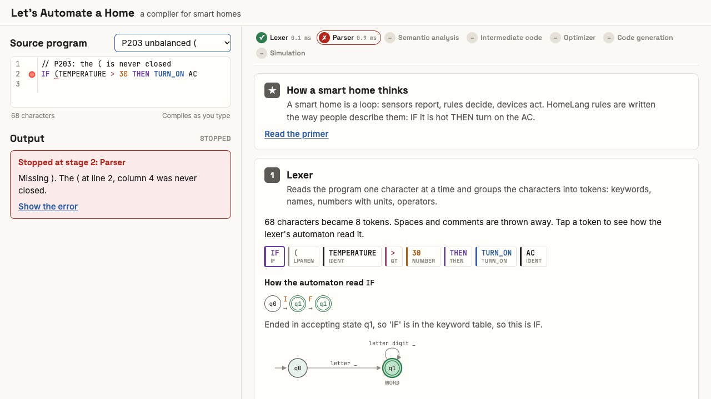 | 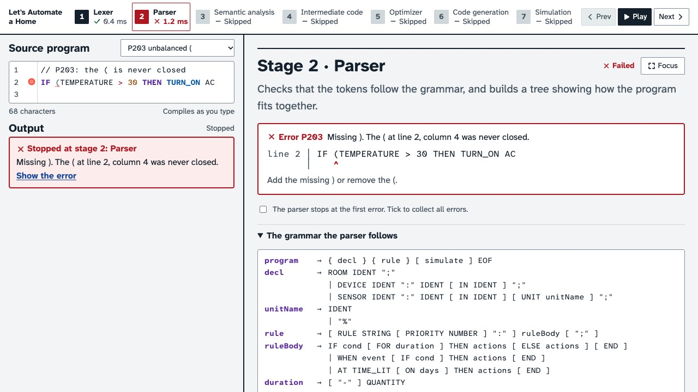 |
| Lexer | 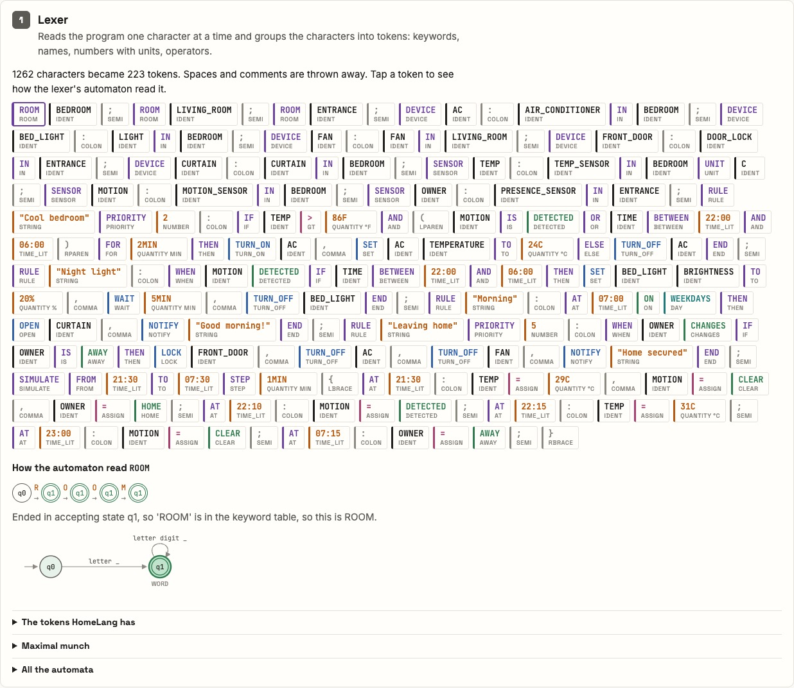 | 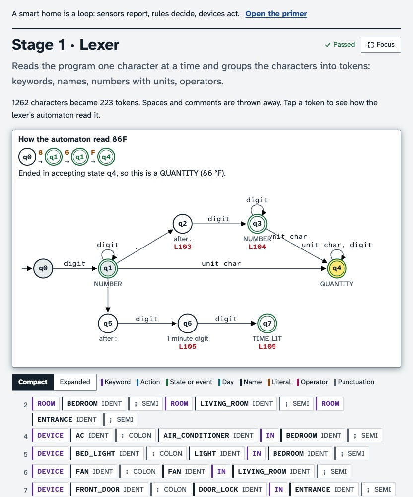 |
| Parser | 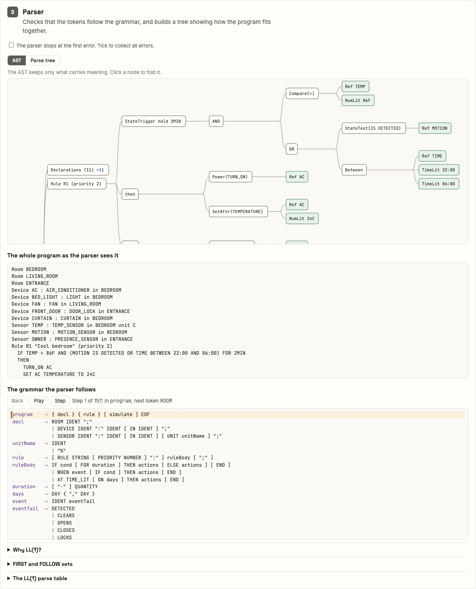 | 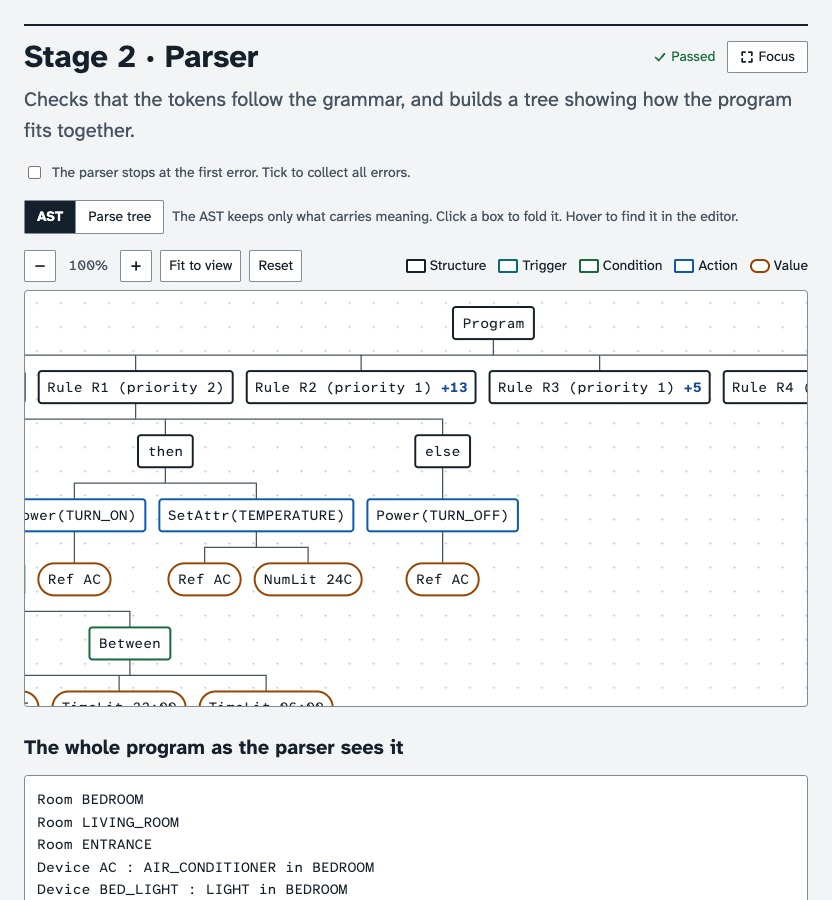 |
| Intermediate code | 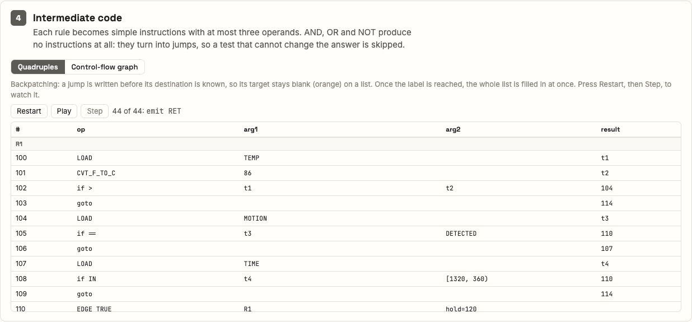 | 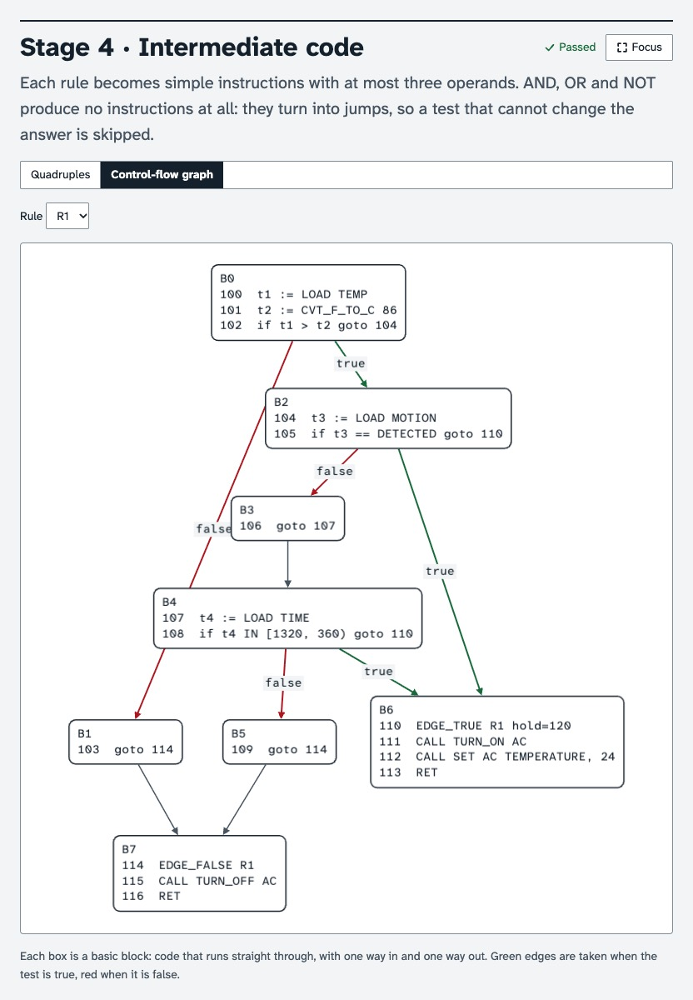 |
| Output | 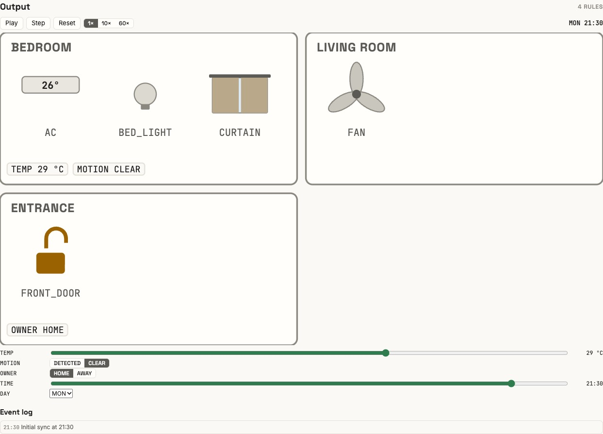 | 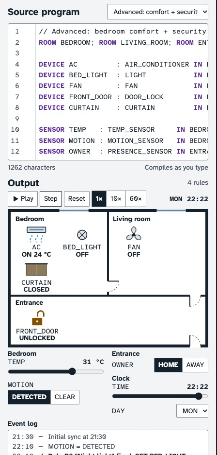 |
